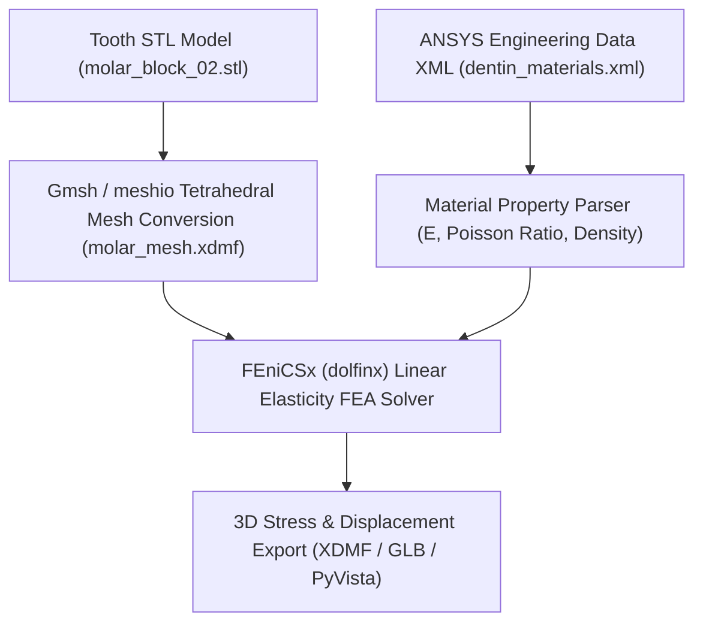

# FEA_for_Dentistry

  -purple "Solver")   

## 개요

본 프로젝트(`Dental_007` / `FEA_for_Dentistry`)는 치아(구치부 상아질 블록 등)의 3D STL 형상 모델을 사면체 유한요소 메쉬(XDMF/HDF5)로 변환하고, ANSYS XML 물성 파싱과 FEniCSx (`dolfinx`) 선형 탄성 유한요소해석(Finite Element Analysis, FEA)을 수행한 뒤 응력(Von Mises stress) 및 변위 분포를 3D GLB/PyVista로 시각화하는 파이프라인입니다.

### Architecture Diagram


## 설치 및 실행 방법

### 1. Python 기본 패키지 설치 (메쉬 변환 및 전·후처리)
```bash
pip install -r requirements.txt
```

### 2. FEniCSx (`fenics-dolfinx`) 설치 안내 (Linux / WSL2 Miniforge 권장)
FEniCSx (`dolfinx`) 솔버는 Linux 또는 Windows WSL2 환경에서 공식 Miniforge (`conda-forge`) 채널을 통해 설치하는 것을 권장합니다. (저장소 용량 및 보안 위생을 위해 대용량 `Miniforge3-*.sh` 설치 스크립트 바이너리는 레포지토리에 포함하지 않으며, 공식 배포처에서 직접 다운로드하여 설치합니다.)

```bash
# 1) 공식 Miniforge 설치 스크립트 다운로드 및 설치 (Linux / WSL2 x86_64)
curl -L -O "https://github.com/conda-forge/miniforge/releases/latest/download/Miniforge3-Linux-x86_64.sh"
bash Miniforge3-Linux-x86_64.sh

# 2) conda-forge 기반 FEniCSx 가상환경 생성 및 활성화
conda create -n fenicsx-env -c conda-forge fenics-dolfinx mpich pyvista gmsh meshio trimesh scipy h5py -y
conda activate fenicsx-env
```

- 공식 Miniforge 배포처: https://github.com/conda-forge/miniforge
- 공식 FEniCSx 설치 문서: https://docs.fenicsproject.org

### 3. 파이프라인 실행
```bash
python main.py
```

## 가중치 파일 안내
본 모듈은 가중치 모델이 불필요한 물리/기하학 유한요소해석(FEA) 모듈이므로, 별도의 딥러닝 가중치 파일이 요구되지 않습니다.

## 라이선스 (License)
본 프로젝트의 소스 코드는 MIT License ([LICENSE](LICENSE), Copyright (c) 2026 Hyunchan An) 하에 배포됩니다.

## 연구용 실행 주의사항
- 기본 실행 주소: 127.0.0.1 (로컬 전용)
- 외부 공개/상용 배포 금지
- API 키·토큰은 환경변수로만 관리
- 오픈 데이터셋 외 민감 의료데이터 사용 금지
- 외부 접근이 필요하면 ALLOW_EXTERNAL_ACCESS=true 로만 명시적 허용
