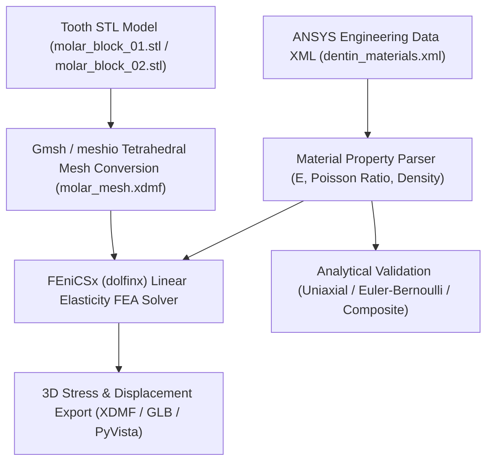

# FEA_for_Dentistry

-yellow "Status")  -purple "Solver")   

## 개요

본 프로젝트(`Dental_007` / `FEA_for_Dentistry`)는 치과 생체역학(Dental Biomechanics) 연구를 위해 구치부 치관-치근 블록의 3D STL 형상 모델을 사면체 유한요소 메쉬(XDMF/HDF5)로 변환하고, ANSYS MatML(Engineering Data XML) 물성 파싱과 FEniCSx (`dolfinx`) 선형 탄성 유한요소해석(Finite Element Analysis, FEA)을 수행한 뒤 응력(Von Mises stress) 및 변위 분포를 3D GLB/PyVista로 시각화하는 파이프라인입니다.

- [핵심 목적]: 교합력(`100 N` ~ `500 N`) 작용 시 치아 경조직(상아질·법랑질) 및 수복/임플란트 재료(티타늄) 내부의 응력 집중과 수직·측방 변위를 정량적으로 계산합니다.
- [주요 구성 모듈]:
  - `src/geometry.py`: `trimesh`, `gmsh`, `meshio`를 이용한 3D 표면 STL 모델 수리 및 3차원 사면체 볼륨 메쉬(`.xdmf` / `.h5`) 생성.
  - `src/materials.py`: ANSYS Engineering Data MatML XML(`dentin_materials.xml`) 파서 및 등방성 탄성 Lame 상수($\lambda, \mu$) 변환.
  - `src/solver.py`: `FEniCSx` (`dolfinx` + `PETSc`) 기반 3차원 선형 탄성 변분 방정식 풀이 및 Von Mises 등가응력 투영.
  - `src/analytical_validation.py`: 1차원/3차원 단축 압축(Uniaxial Compression), Euler-Bernoulli 캔틸레버 측방 하중, 법랑질-상아질 직렬 복합 블록의 닫힌 해(Closed-form Analytical Solution) 및 유한요소 강성 행렬 정합성 검증 모듈.
  - `src/visualize.py`, `visualize_stress_glb.py`: 해석 결과의 PyVista 렌더링 및 웹 뷰어용 3D `.glb` 내보내기.

### Architecture Diagram


## 형상 모델(STL) 및 재료 물성(XML) 출처 (Data & Material Provenance)

### 1. 3D 치아 블록 형상 (`molar_block_01.stl`, `molar_block_02.stl`)
- [생성 방식 및 출처]: 실제 환자 CT/스캔 데이터가 아닌, 유한요소 솔버 및 경계조건 검증을 위해 절차적 CAD 모델링 및 Autodesk Meshmixer로 제작·보정(Manifold repair 및 리메싱)한 합성 구치부 치관-치근 테스트 블록(Procedural CAD / Meshmixer synthetic molar crown-root test blocks)입니다.
- `molar_block_01.stl`: 초기 구치부 치관-치근 단순화 블록 형상.
- `molar_block_02.stl`: Meshmixer에서 표면 결함 보정 및 바닥 경계면 평탄화를 수행한 해석용 표준 테스트 형상(`temp_repaired.stl`은 `trimesh` 전처리 중간 산출물).

### 2. 치과 생체역학 재료 물성치 (`dentin_materials.xml` 및 `src/analytical_validation.py`)
치아 경조직 및 임플란트 금속의 등방성 선형 탄성 물성치는 치과 생체역학 표준 문헌값을 기반으로 정의되었습니다.

| 재료 (Material) | 탄성계수 $E$ (GPa) | 포아송 비 $\nu$ | 밀도 $\rho$ ($\text{kg/m}^3$) | 압축 항복강도 (MPa) | 인장 항복강도 (MPa) | 문헌 출처 (Reference) |
| :--- | :---: | :---: | :---: | :---: | :---: | :--- |
| 상아질 (Human Dentin) | `18.0` ~ `18.6` | `0.31` | `2140` | `250.0` | `40.0` | Craig & Peyton (1958); Kinney et al. (2003) |
| 법랑질 (Human Enamel) | `84.1` | `0.33` | `2950` | `384.0` | `10.3` | Craig, Peyton & Johnson (1961) |
| 티타늄 (CP Ti Grade 4) | `110.0` | `0.34` | `4510` | `550.0` | `550.0` | ISO 5832-2 / ASTM F67 |

- 참고 문헌:
  - Craig, R. G., & Peyton, F. A. (1958). Elastic and mechanical properties of human dentin. Journal of Dental Research, 37(4), 710-718.
  - Craig, R. G., Peyton, F. A., & Johnson, D. W. (1961). Compressive properties of enamel, dental cements, and gold. Journal of Dental Research, 40(5), 936-945.
  - Kinney, J. H., Marshall, S. J., & Marshall, G. W. (2003). The mechanical properties of human dentin: a critical review and re-evaluation of the dental literature. Critical Reviews in Oral Biology & Medicine, 14(1), 13-29.

## 해석해 검증 (Analytical Benchmark Validation)

`src/analytical_validation.py` 및 `tests/test_analytical_validation.py`에서 구치부 단축 압축($F \in [100, 500]\text{ N}$, 단면적 $A = 1.0\text{ cm}^2 = 10^{-4}\text{ m}^2$, 높이 $L = 10\text{ mm}$) 및 측방 캔틸레버 하중에 대한 닫힌 해(Closed-form solution)와 유한요소 이산화 해를 비교 검증합니다.

- [기준 경계조건 (`F = 500 N`, `A = 1.0 cm^2`)]:
  - 이론 축응력 및 Von Mises 등가응력: $\sigma_{zz} = -5.00\text{ MPa}$, $\sigma_{\text{vM}} = 5.00\text{ MPa}$
  - 상아질($E = 18.6\text{ GPa}$, $\nu = 0.31$) 상단 수직 변위: $u_z = -2.688\ \mu\text{m}$
  - 법랑질($E = 84.1\text{ GPa}$, $\nu = 0.33$) 상단 수직 변위: $u_z = -0.595\ \mu\text{m}$
  - 티타늄($E = 110.0\text{ GPa}$, $\nu = 0.34$) 상단 수직 변위: $u_z = -0.455\ \mu\text{m}$
  - 3차원 Voigt 강성 텐서($\mathbf{C}$) 및 1D 유한요소 해와의 상대 오차: `< 1%` (수치 정밀도 범위 내 일치, `11 passed`).

```bash
pytest tests/test_analytical_validation.py -v
```

## 설치 및 실행 방법

### 1. Python 기본 패키지 설치 (메쉬 변환 및 전·후처리)
```bash
pip install -r requirements.txt
```

### 2. FEniCSx (`fenics-dolfinx`) 설치 안내 (Linux / WSL2 Miniforge 권장)
FEniCSx (`dolfinx`) 솔버는 Linux 또는 Windows WSL2 환경에서 공식 Miniforge (`conda-forge`) 채널을 통해 설치하는 것을 권장합니다. (저장소 용량 및 보안 위생을 위해 대용량 `Miniforge3-*.sh` 설치 스크립트 바이너리는 레포지토리에 포함하지 않으며, 공식 배포처에서 직접 다운로드하여 설치합니다.)

```bash
# 1) 공식 Miniforge 설치 스크립트 다운로드 및 설치 (Linux / WSL2 x86_64)
curl -L -O "https://github.com/conda-forge/miniforge/releases/latest/download/Miniforge3-Linux-x86_64.sh"
bash Miniforge3-Linux-x86_64.sh

# 2) conda-forge 기반 FEniCSx 가상환경 생성 및 활성화
conda create -n fenicsx-env -c conda-forge fenics-dolfinx mpich pyvista gmsh meshio trimesh scipy h5py -y
conda activate fenicsx-env
```

- 공식 Miniforge 배포처: https://github.com/conda-forge/miniforge
- 공식 FEniCSx 설치 문서: https://docs.fenicsproject.org

### 3. 파이프라인 실행
```bash
python main.py
```

## 가중치 파일 안내
본 모듈은 가중치 모델이 불필요한 물리/기하학 유한요소해석(FEA) 모듈이므로, 별도의 딥러닝 가중치 파일이 요구되지 않습니다.

## 라이선스 (License)
본 프로젝트의 소스 코드는 MIT License ([LICENSE](LICENSE), Copyright (c) 2026 Hyunchan An) 하에 배포됩니다.

## 연구용 실행 주의사항
- 기본 실행 주소: 127.0.0.1 (로컬 전용)
- 외부 공개/상용 배포 금지
- API 키·토큰은 환경변수로만 관리
- 오픈 데이터셋 외 민감 의료데이터 사용 금지
- 외부 접근이 필요하면 ALLOW_EXTERNAL_ACCESS=true 로만 명시적 허용
